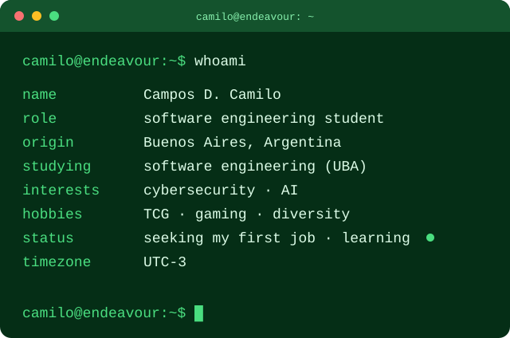

<!-- HERO -->

  <picture>
    <source media="(prefers-color-scheme: light)" srcset="./assets/whoami/whoami-light.svg">
    
  </picture>
  <picture>
    <source media="(prefers-color-scheme: light)" srcset="./assets/visual-map/visual-map-light.svg">
    
  </picture>

  <picture>
    <source media="(prefers-color-scheme: light)" srcset="https://img.shields.io/badge/B1-BBF7D0?&label=English&labelColor=15803D&style=for-the-badge">
    
  </picture>
  <picture>
    <source media="(prefers-color-scheme: light)" srcset="https://img.shields.io/badge/Native-BBF7D0?&label=Spanish&labelColor=15803D&style=for-the-badge">
    
  </picture>

  <h2>Skills</h2>
  ━━━━━━━━ ☆ ★ ☆ ━━━━━━━━

<pre>
<b>skills/</b>
├── <b>languages/</b>
│   ├──  python.py         # scripting / backend
│   ├──  cpp.cpp           # systems / algorithms
│   ├──  java.java         # OOP / backend
│   └──  rust.rs           # systems / concurrency
├── <b>web/</b>
│   ├──  html5.html        # markup
│   ├──  css3.css          # styles
│   └──  javascript.js     # language
├── <b>database/</b>
│   └──  postgresql.sql    # RDBMS
└── <b>devops/</b>
    ├──  docker            # containers
    ├──  linux             # OS
    ├──  bash              # shell
    └──  git               # version control
</pre>

  <h2>Let's Connect!</h2>
  ━━━━━━━━ ☆ ★ ☆ ━━━━━━━━

  <a href="https://www.linkedin.com/in/camilocamposduran">
    <picture>
      <source media="(prefers-color-scheme: light)" srcset="https://custom-icon-badges.demolab.com/badge/LinkedIn-15803D?logo=linkedin-white&logoColor=F0FDF4&style=for-the-badge">
      
    </picture>
  </a>

  Hecho en Argentina con mucho amor y café.

